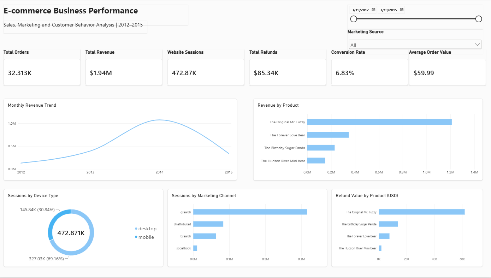

# E-commerce Business Performance and Customer Behaviour Analysis

**Maven Fuzzy Factory | Data Analytics Project**

## About the Project

For this project, I worked with historical data from Maven Fuzzy Factory, an e-commerce business, covering March 2012 to April 2015.

The aim was to understand how the business was performing by looking at its sales, website traffic, marketing channels, customer behaviour, product performance and refunds.

I used Python, SQL and Power BI to explore the data, answer business questions and present the findings in an interactive dashboard.

## What I Set Out to Understand

The analysis focused on a few important business questions:

- How much revenue was the business generating?
- Which products were performing best?
- Where was website traffic coming from?
- Which devices were customers using?
- How many website sessions resulted in orders?
- How much revenue was being refunded?
- How did revenue change over time?

## Tools Used

| Tool | How I Used It |
|---|---|
| Python and pandas | Inspecting, cleaning and preparing the data |
| PostgreSQL | Storing and managing the datasets |
| SQL | Answering the business questions |
| Power BI | Building the interactive dashboard |
| Git and GitHub | Managing and documenting the project |

## Working with the Data

I started by inspecting the six datasets and reviewing the data dictionary to understand their structure and relationships.

The datasets contained information about website sessions, pageviews, orders, order items, refunds and products, with a combined total of **1,595,519 records**.

During the quality assessment, I identified missing marketing attribution values and missing referral information in the website sessions dataset. I also checked for duplicates, validated dataset relationships and tested key business rules.

Rather than filling missing marketing values with assumptions, I retained them and treated sessions without a recorded marketing source as unattributed during the analysis.

After preparing the datasets with Python and pandas, I loaded them into PostgreSQL for further analysis.

## Key Findings

The analysis revealed several interesting things about the business.

### Overall Performance

| Metric | Result |
| --- | ---: |
| Total Orders | 32,313 |
| Total Revenue | $1,938,509.75 |
| Average Order Value | $59.99 |
| Website Sessions | 472,871 |
| Conversion Rate | 6.83% |
| Total Refunds | $85,338.69 |
| Refund Records | 1,731 |

### Product Performance

The Original Mr. Fuzzy generated the highest revenue at **$1,211,057.74**, making it the strongest-performing product among the four products in the dataset.

### Marketing and Website Traffic

Google Search was the largest traffic source, bringing in 316,035 sessions. However, 83,328 sessions had no recorded marketing attribution.

Desktop users accounted for 69.2% of website sessions, compared with 30.8% from mobile devices.

### Revenue and Refunds

December 2014 recorded the highest monthly revenue at $144,823.02. March 2012 recorded the lowest at $2,999.40, although the data for that month only begins on 19 March.

The business also recorded 1,731 refunds, amounting to $85,338.69.

## Power BI Dashboard

I developed an interactive Power BI dashboard to bring the findings together and make the business performance easier to explore.

The dashboard includes:

- Total Orders, Revenue and Refunds
- Average Order Value
- Website Sessions and Conversion Rate
- Monthly Revenue Trends
- Revenue by Product
- Sessions by Marketing Channel
- Sessions by Device Type
- Refund Analysis

It also includes date and marketing source filters for exploring the results.

**Dashboard Preview**



## Recommendations

Based on the analysis, I identified a few areas the business could focus on:

1. Improve marketing tracking to better understand where unattributed website traffic comes from.
2. Review the mobile shopping experience and identify ways to improve engagement and conversions.
3. Evaluate marketing channels based on the orders and revenue they generate, not just website traffic.
4. Use product performance trends to guide promotional and inventory decisions.
5. Monitor refunds regularly to identify possible product or customer experience issues.

## Limitations

There were a few limitations in the available data. Marketing attribution information was missing for some sessions, and the products dataset did not include product categories or types.

March 2012 was also a partial month, so its revenue could not be compared directly with complete months. Refunds were examined by count and value, but a formal refund rate was not calculated.

## Repository Structure

```text
Ecommerce_business_performance/
│
├── README.md
├── .gitignore
├── requirements.txt
│
├── scripts/
├── notebooks/
├── sql/
├── documentation/
├── reports/
├── powerbi/
│   ├── dashboard/
│   └── screenshots/
│
└── data/
    ├── raw/
    └── processed/
```

*Raw and processed datasets are excluded from GitHub.*

## Final Thoughts

This project gave me the opportunity to work through an end-to-end data analytics process, from inspecting and preparing raw data to querying a database and building an interactive dashboard.

More importantly, it helped me connect the technical side of data analysis with the business questions behind the numbers. The findings provide a clearer picture of Maven Fuzzy Factory's performance and highlight areas where further investigation and improvement may be valuable.
